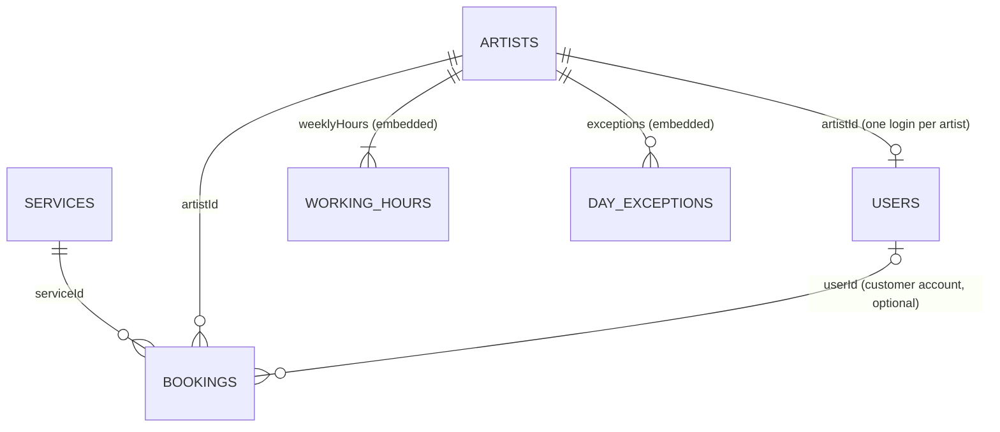

# Tattoo Studio database

MongoDB Atlas, database `tattoo studio` (tests use `tattoo_studio_test`). Six collections, linked by ids.
The rules below (required fields, maximum lengths, ranges) are checked by the server on every request
(the request records in `server/.../dto`, Bean Validation). The website's forms use the very same
numbers from `client/src/lib/limits.ts`, and the server test `LimitsSyncTest` fails if the two ever differ.

Types: **String** (text), **Integer** (whole number), **Decimal** (exact money, Decimal128), **Boolean**,
**DateTime** (UTC instant), **Date** / **Time**, **Enum** (one of a fixed list), **List**.
The `_id` (ObjectId) of every document is not counted below.

## services

| Field | Type | Required | Rule |
|---|---|---|---|
| `name` | String | yes | max 60 |
| `description` | String | | max 300 |
| `price` | Decimal | yes | 0–1000.00 EUR |
| `label` | String | | max 12, e.g. "MD 01" |
| `palette` | String | yes | a palette name (blue, sunset, lime, mint, violet) |
| `sortOrder` | Integer | yes | menu position |
| `active` | Boolean | yes | false = hidden from the booking page |

7 fields · 4 types (String, Decimal, Integer, Boolean)

## artists

| Field | Type | Required | Rule |
|---|---|---|---|
| `name` | String | yes | max 60 |
| `handle` | String | | max 40, e.g. "@jaxcuts" |
| `specialty` | String | | max 60 |
| `bio` | String | | max 500 |
| `photoUrl` | String | | max 500, a web address or /path |
| `accent` | Enum | yes | red, orange, yellow, green, cyan, purple |
| `sortOrder` | Integer | yes | |
| `active` | Boolean | yes | false = off the booking page, login blocked |
| `weeklyHours` | List | yes | max 7 × `{ day: Enum, start: Time, end: Time }`, start on the full hour, start < end |
| `exceptions` | List | yes | max 100 × `{ date: Date, closed: Boolean, start: Time, end: Time, note: String max 100 }` |

10 fields · 5 types (String, Enum, Integer, Boolean, List)

## bookings

| Field | Type | Required | Rule |
|---|---|---|---|
| `code` | String | yes | unique, e.g. FS-7K3QXM |
| `serviceId` | String | yes | → services |
| `serviceName` | String | yes | copied when booked, so history survives service changes |
| `priceAtBooking` | Decimal | yes | copied when booked |
| `artistId` | String | yes | → artists |
| `startsAt` / `endsAt` | DateTime | yes | one 60-minute slot, 1 hour to 30 days ahead, inside the artist's hours |
| `slots` | List of DateTime | yes | unique per artist while booked (no double booking, database index) |
| `status` | Enum | yes | BOOKED, CANCELLED, DONE, NO_SHOW |
| `customerName` | String | yes* | max 60 |
| `phone` | String | yes* | max 30, a valid phone number, stored as +359… |
| `email` | String | | max 120, an email address |
| `notes` | String | | max 300 |
| `anonymized` | Boolean | yes | true once customer details are wiped (24 h after the appointment) |
| `userId` | String | | → users, when booked while signed in |
| `createdAt`, `cancelledAt`, `reminderSentAt` | DateTime | `createdAt` | |

18 fields · 6 types (String, Decimal, DateTime, List, Enum, Boolean). *Required until wiped for privacy.

## reviews

| Field | Type | Required | Rule |
|---|---|---|---|
| `name` | String | yes | max 60 |
| `rating` | Integer | yes | 1–5 |
| `text` | String | yes | max 500 |
| `approved` | Boolean | yes | shown on the site only when true |
| `createdAt` | DateTime | yes | |

5 fields + id · 4 types (String, Integer, Boolean, DateTime)

## messages

| Field | Type | Required | Rule |
|---|---|---|---|
| `name` | String | yes | max 60 |
| `contact` | String | yes | max 120, an email or a phone number |
| `text` | String | yes | max 1000 |
| `read` | Boolean | yes | |
| `readAt` | DateTime | | when the admin marked it read |
| `senderKey` | String | yes | the contact in one form (phone as +359…, email in lower case), to count messages per sender |
| `senderMessageNumber` | Integer | yes | 1st, 2nd, … message from this contact |
| `createdAt` | DateTime | yes | deleted automatically after 90 days |

8 fields · 4 types (String, Boolean, DateTime, Integer)

## users

| Field | Type | Required | Rule |
|---|---|---|---|
| `username` | String | yes | unique, not case-sensitive. Staff: 3–30 of a-z 0-9 . _ - ; customers: their email (max 120) |
| `passwordHash` | String | yes | BCrypt hash of a password of 8–200 characters (never sent out) |
| `role` | Enum | yes | USER (customer), ARTIST, ADMIN |
| `active` | Boolean | yes | false = blocked |
| `artistId` | String | artists | → artists, unique |
| `name`, `email`, `phone` | String | customers | max 60 / 120 / 30 |
| `createdAt`, `lastLoginAt`, `passwordChangedAt` | DateTime | | tokens issued before `passwordChangedAt` stop working (so do tokens whose role or artist no longer matches) |
| `loginCount` | Integer | yes | how many times this login signed in |

13 fields · 5 types (String, Enum, Boolean, DateTime, Integer)
