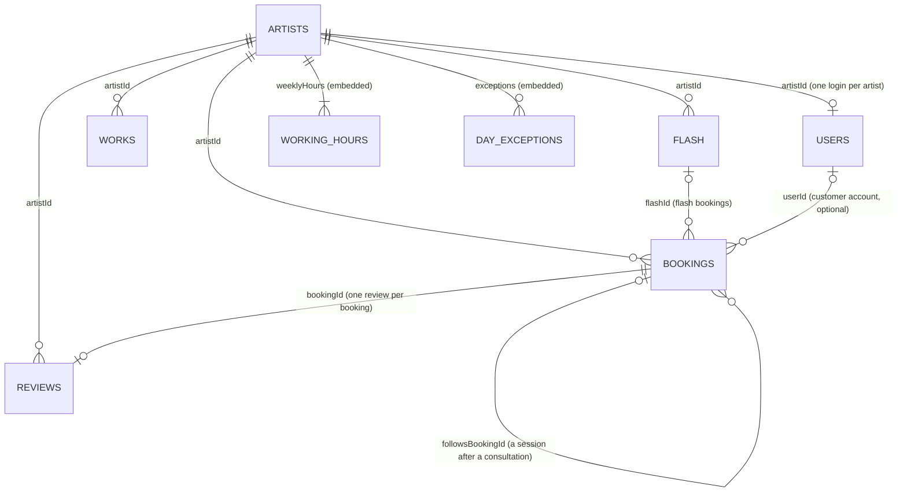

# Blade & Brush database

MongoDB Atlas, database `tattoo_studio` (tests use `tattoo_studio_test`). Eight collections, linked by ids.
The rules below (required fields, maximum lengths, ranges) are checked by the server on every request
(the request records in `server/.../dto`, Bean Validation). The website's forms use the very same
numbers from `client/src/lib/limits.ts`, and the server test `LimitsSyncTest` fails if the two ever differ.

Types: **String** (text), **Integer** (whole number), **Decimal** (exact money, Decimal128), **Boolean**,
**DateTime** (UTC instant), **Date** / **Time**, **Enum** (one of a fixed list), **List**,
**Image** (`{ id, url, thumbUrl }`: where the picture is kept and its two addresses).
The `_id` (ObjectId) of every document is not counted below.

## artists

| Field | Type | Required | Rule |
|---|---|---|---|
| `name` | String | yes | max 60, e.g. "Kai" |
| `slug` | String | yes | unique, max 40 of a-z 0-9 -, the page address (/artists/kai) |
| `style` | String | | max 60, e.g. "Bold traditional colour" |
| `bio` | String | | max 600 |
| `hourlyRate`, `dayRate` | Decimal | | 0–1000 / 0–5000 EUR, for custom work |
| `signaturePiece` | Image | | the picture on the artist's hanging scroll (no portrait photos) |
| `breakMinutes` | Integer | yes | 0–120 in steps of 30 (default 30), kept free after each client |
| `sortOrder` | Integer | yes | |
| `active` | Boolean | yes | false = off the site (designs too), login blocked |
| `weeklyHours` | List | yes | max 7 × `{ day: Enum, start: Time, end: Time }`, start on the hour or half hour, start < end |
| `exceptions` | List | yes | max 100 × `{ date: Date, closed: Boolean, start: Time, end: Time, note: String max 100 }` |

12 fields · 7 types (String, Decimal, Image, Integer, Boolean, List, Enum)

## flash

| Field | Type | Required | Rule |
|---|---|---|---|
| `artistId` | String | yes | → artists |
| `name` | String | yes | max 60 |
| `widthCm`, `heightCm` | Integer | yes | 1–60; the longer side gives the size filter (small up to 8, medium up to 12, large) |
| `durationMinutes` | Integer | yes | 30–720, a multiple of 30 |
| `price` | Decimal | yes | 1–5000 EUR |
| `image` | Image | | the drawing |
| `available` | Boolean | yes | the artist's switch: false = off the sheet |
| `sortOrder` | Integer | yes | |
| `createdAt` | DateTime | yes | |

10 fields · 6 types (String, Integer, Decimal, Image, Boolean, DateTime). Whether a design is booked is
not stored here: the bookings say so (see `claimsFlash`).

## works

| Field | Type | Required | Rule |
|---|---|---|---|
| `artistId` | String | yes | → artists; up to 60 per artist |
| `image` | Image | yes | |
| `caption` | String | | max 60 |
| `createdAt` | DateTime | yes | |

4 fields · 4 types (String, Image, DateTime)

## bookings

| Field | Type | Required | Rule |
|---|---|---|---|
| `code` | String | yes | unique, e.g. K7Q2-M9 |
| `type` | Enum | yes | FLASH, CONSULTATION, SESSION |
| `status` | Enum | yes | PENDING (deposit not paid yet), BOOKED, CANCELLED, EXPIRED, DONE, NO_SHOW |
| `artistId` | String | yes | → artists |
| `startsAt` / `endsAt` | DateTime | yes | on the 30-minute grid; flash and consultations 2 hours to 30 days ahead, inside the artist's hours |
| `slots` | List of DateTime | yes | every 30-minute step from the start to the end of the break after it |
| `holdsTime` | Boolean | yes | true unless cancelled or expired. Unique index on (artist, slot) for these: no double booking, enforced by the database |
| `claimsFlash` | Boolean | yes | true while a flash booking is held, booked or done. Unique index on `flashId` for these: every design is booked once |
| `title` | String | | the design's name or the session's description (max 100), copied so history survives changes |
| `flashId`, `widthCm`, `heightCm` | String, Integer | flash | → flash, size copied when booked |
| `price` | Decimal | flash, session | |
| `depositAmount` | Decimal | | 30 EUR for flash, set by the artist for sessions |
| `depositStatus` | Enum | yes | NONE, WAITING, PAID, REFUNDED, KEPT, NOT_PAID |
| `depositMethod` | Enum | | ONLINE, CASH |
| `depositDueAt`, `depositPaidAt`, `depositRefundedAt` | DateTime | | due: 15 minutes after a flash booking, 72 hours after a session is reserved |
| `paymentId` | String | | unique, random, identifies the payment page |
| `customerName` | String | yes* | max 60 |
| `phone` | String | yes* | max 30, a valid phone number, stored as +359… |
| `email` | String | yes* | max 120, an email address |
| `dateOfBirth` | Date | yes* | 18 or older on the day of the appointment |
| `notes` | String | | max 300 |
| `consentAt` | DateTime | yes | when the customer confirmed 18+, the consent form and (with a deposit) the deposit policy |
| `idea`, `placement`, `sizeCm`, `colour` | String, Enum, Integer, Enum | consultation | idea max 1000, size 1–200 cm |
| `photos` | List of Image | | up to 5 reference photos (consultations) |
| `followsBookingId` | String | | sessions: → the consultation (or session) the customer came from |
| `anonymized` | Boolean | yes | true once customer details and photos are wiped (180 days after the appointment) |
| `userId` | String | | → users, when booked while signed in (sessions: copied from the consultation) |
| `createdAt`, `cancelledAt`, `reminderSentAt`, `reviewedAt` | DateTime | `createdAt` | |

37 fields · 8 types (String, Enum, DateTime, List, Boolean, Integer, Decimal, Date). *Required until wiped for privacy.

## reviews

| Field | Type | Required | Rule |
|---|---|---|---|
| `artistId` | String | yes | → artists |
| `bookingId` | String | | unique, → bookings: the finished appointment it is about (demo reviews have none) |
| `name` | String | yes | max 60, the customer's first name |
| `rating` | Integer | yes | 1–5 |
| `text` | String | yes | max 500 |
| `approved` | Boolean | yes | shown on the site only when true |
| `createdAt` | DateTime | yes | |

7 fields · 4 types (String, Integer, Boolean, DateTime)

## messages

| Field | Type | Required | Rule |
|---|---|---|---|
| `name` | String | yes | max 60 |
| `contact` | String | yes | max 120, an email or a phone number |
| `text` | String | yes | max 1000 |
| `photos` | List of Image | yes | up to 5 |
| `read` | Boolean | yes | handled by the studio |
| `readAt` | DateTime | | when it was marked handled |
| `senderKey` | String | yes | the contact in one form (phone as +359…, email in lower case), to count messages per sender |
| `senderMessageNumber` | Integer | yes | 1st, 2nd, … message from this contact |
| `createdAt` | DateTime | yes | deleted automatically after 90 days, photos included |

9 fields · 5 types (String, List, Boolean, DateTime, Integer)

## users

| Field | Type | Required | Rule |
|---|---|---|---|
| `username` | String | yes | unique, not case-sensitive. Staff: 3–30 of a-z 0-9 . _ - ; customers: their email (max 120) |
| `passwordHash` | String | yes | BCrypt hash of a password of 8–200 characters (never sent out) |
| `role` | Enum | yes | USER (customer), ARTIST, ADMIN |
| `active` | Boolean | yes | false = blocked |
| `artistId` | String | artists | → artists, unique |
| `name`, `email`, `phone` | String | customers | max 60 / 120 / 30 |
| `dateOfBirth` | Date | customers | 18 or older |
| `createdAt`, `lastLoginAt`, `passwordChangedAt` | DateTime | | tokens issued before `passwordChangedAt` stop working (so do tokens whose role or artist no longer matches) |
| `loginCount` | Integer | yes | how many times this login signed in |

14 fields · 6 types (String, Enum, Boolean, Date, DateTime, Integer)

## Pictures

Uploaded pictures are not stored in MongoDB. They go to Cloudinary (folder `blade-and-brush/`, when
`app.images.cloudinary-url` is set) or to `server/uploads/` while developing; the documents keep their
`Image` (`id`, `url`, `thumbUrl`). Deleting a design, a portfolio photo, a message or a booking, or wiping
a booking's details, deletes its pictures too.
